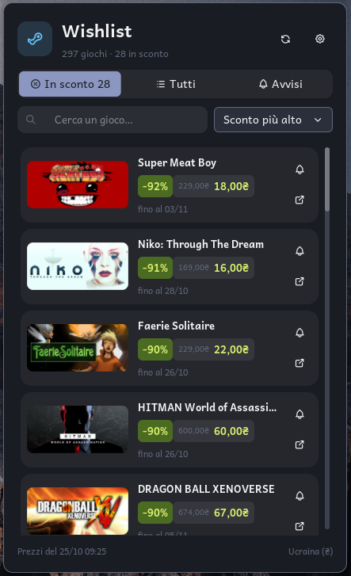

# Noctalia plugins

Plugins for the [Noctalia](https://noctalia.dev) shell.

[](https://send.monobank.ua/jar/6L3skCLzFG)

| Plugin | Id | What it does |
|---|---|---|
| [Steam Wishlist](wishlist/) | `sergiiosy/wishlist` | Discounts on the games of your Steam wishlist, with prices for your region, price alerts and covers. |



## Install

Add this repository as a plugin source, then enable the plugin:

```sh
noctalia msg plugins source add sergiiosy git https://github.com/sergiiosy/noctalia-plugins
noctalia msg plugins enable sergiiosy/wishlist
```

The plugin then shows up in **Settings → Plugins**, and updates arrive with
`noctalia msg plugins update`.

To remove it:

```sh
noctalia msg plugins disable sergiiosy/wishlist
noctalia msg plugins source remove sergiiosy
```

## Requirements

Noctalia 5.3 or newer (plugin API 33).

## Support

If a plugin is useful to you, you can buy me a coffee through a
[monobank jar](https://send.monobank.ua/jar/6L3skCLzFG). Any Visa or Mastercard works, from any
country, as do Apple Pay and Google Pay. The amount is in Ukrainian hryvnias and your bank
converts it.

## License

MIT, see [LICENSE](LICENSE).
