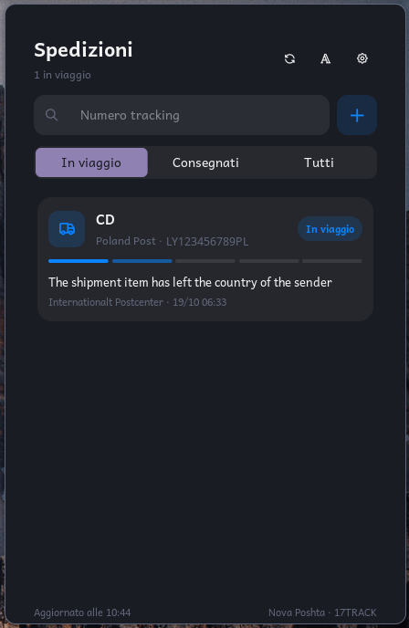

# Parcels

Track your incoming parcels right from the Noctalia bar: an icon with a badge, a panel to
manage your shipments, two desktop widgets, and a notification whenever a parcel moves.



| Carrier | Tracked through | Key needed? |
|---|---|---|
| **Nova Poshta** | Nova Poshta's official API | No |
| **Ukrposhta** | 17TRACK | Yes, free |
| **China** (China Post, Cainiao, Yanwen, …) and most other carriers | 17TRACK | Yes, free |

The carrier is recognised from the number: 14 digits is Nova Poshta, everything else goes
through 17TRACK, which finds the carrier by itself.

| Plugin | |
|---|---|
| Id | `sergiiosy/parcels` |
| Entries | `sergiiosy/parcels:service`, `sergiiosy/parcels:bar`, `sergiiosy/parcels:panel`, `sergiiosy/parcels:desktop`, `sergiiosy/parcels:next` |
| Languages | English, Italian |

## Usage

1. Add the bar widget `sergiiosy/parcels:bar`.
2. For anything that is not Nova Poshta, get a free [17TRACK API key](https://api.17track.net)
   and paste it in **Settings → Plugins → Parcels**.
3. Optionally add the desktop widgets (`noctalia msg desktop-widgets-edit`):
   - `sergiiosy/parcels:desktop`: the list of parcels;
   - `sergiiosy/parcels:next`: a small square with the most urgent parcel.

- **Bar**: a parcel icon with a badge counting the parcels on their way. It turns **orange**
  when something is ready for pickup or out for delivery, and **red** when a parcel has a
  problem. Click opens the panel, right click refreshes, the tooltip lists the parcels.
- **Panel** (`noctalia msg panel-toggle sergiiosy/parcels:panel`):
  - paste a tracking number and press Enter or **+**. To give it a name, write it after the
    number: `20450012345678 Shoes`. While you type, the recognised carrier shows up on the right;
  - filter by On the way / Delivered / All;
  - each card shows the status, a 5-step progress bar, the last event with place and time, and
    the expected date. Click a card for the event history, *Copy number* and *Delete*;
  - **Aa** picks the font of the panel and widgets (*Default* uses the shell font).
- **Notifications**: when a parcel changes status.

### 17TRACK key

1. Sign up at <https://api.17track.net> and copy the key from the dashboard.
2. Paste it in **Settings → Plugins → Parcels → 17TRACK API key**.

The free plan has a quota of registrations: each parcel uses just one, the first time you add
it. Later updates are free.

## Requirements

- `fc-list` (fontconfig), for the font picker. It is almost always already installed.

## Settings

| Setting | Default | Notes |
|---|---|---|
| 17TRACK API key | empty | Needed for Ukrposhta, China and the other carriers |
| Nova Poshta phone | empty | Optional (`380XXXXXXXXX`): unlocks branch and delivery details |
| Refresh every (minutes) | 30 | How often parcels on their way are checked (5–720) |
| Notify on status change | on | |
| Show the number of parcels | on | Bar widget setting |
| Maximum parcels / show delivered | 6 / on | List desktop widget settings |

## Statuses

| Status | Colour | Meaning |
|---|---|---|
| Created | grey | The sender created the shipment |
| On the way | blue | In transit |
| Out for delivery | indigo | The courier is delivering it |
| Ready for pickup | orange | At the branch or parcel locker |
| Delivered | green | Delivered; no longer checked |
| Delivery failed / Problem | red | Failed attempt, refused, storage expired, … |
| Not found yet | grey | The carrier has no data on this number yet |
| 17TRACK key missing | red | This carrier needs the key |

## IPC

```sh
noctalia msg plugin sergiiosy/parcels:service all add <number> [name]
noctalia msg plugin sergiiosy/parcels:service all remove <number>
noctalia msg plugin sergiiosy/parcels:service all refresh
noctalia msg plugin sergiiosy/parcels:service all font "Inter"   # empty = shell font
```

## Notes

- **Network**, over HTTPS:
  - `api.novaposhta.ua` for Nova Poshta numbers (no key);
  - `api.17track.net` for every other number, with your key. The numbers you add are sent to
    the carrier that tracks them, and nothing else.
- **Files**: everything is written in the plugin data directory
  (`~/.local/state/noctalia/plugins/data/sergiiosy/parcels/`): `parcels.json` (your parcels)
  and `prefs.json` (the chosen font). The key and the phone stay in Noctalia's settings.
- **Processes**: `fc-list : family` once, the first time the font picker opens.
- **A new 17TRACK parcel without data**: after the registration 17TRACK needs a few minutes
  to collect the events. The plugin says so and checks again by itself after 3 minutes.
- **National Ukrposhta numbers** (13 digits only) may not be recognised by 17TRACK. The
  international ones (`RB…UA`, `CV…UA`) work.
- **Nova Poshta history**: Nova Poshta's API only gives the current status, so the history is
  built from the changes seen since you added the parcel.
- **17TRACK event descriptions** come in the carrier's language, often English.
